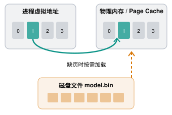

## 1 文件映射段

在虚拟内存中存在着一块文件映射段（Memory-mapped File Region），主要作用是：将磁盘上的文件映射到进程的虚拟地址空间，让程序可以像访问普通内存一样访问文件内容。

### 1.1 工作原理

假设磁盘上存在一个 1 GB 的文件：

```
/data/model.bin
```

传统的读取方式是：

```
read(fd, buffer, size);
```
操作系统将文件数据复制到用户提供的 `buffer` 中。

而使用 `mmap()`：

```
void* ptr = mmap(
    nullptr,
    size,
    PROT_READ,
    MAP_PRIVATE,
    fd,
    0
);
```

操作系统为文件建立一段虚拟地址映射。



访问映射地址时，CPU 通过页表找到物理页；未驻留的文件页可能触发缺页异常，由操作系统加载。

这里有三个关键点：

1. `mmap()` 通常不会立即把整个文件加载进物理内存。
2. 当程序首次访问尚未驻留的页面时，可能发生 Page Fault（缺页异常）。
3. 操作系统将文件对应的数据页加载到内存，建立映射，随后程序就可以直接访问。

因此，映射一个 1 GB 文件，不意味着立即占用 1 GB 物理内存。

### 1.2 文件映射的用途

用途一：高效访问大文件

例如加载模型权重、数据库文件、搜索索引等。

程序可以按需访问文件中的数据，避免先将整个文件显式读取到用户缓冲区。

用途二：加载动态链接库

Linux 中的 `.so` 文件通常通过文件映射机制加载。

例如：

```
libc.so
libstdc++.so
libcuda.so
```

这些库的代码段可以被多个进程映射，底层只读物理页面可以共享，从而减少内存占用。

用途三：进程间共享内存

两个进程可以通过 `MAP_SHARED` 映射同一个文件。

```
Process A ──┐
            ├── Shared Physical Pages
Process B ──┘
```

这样两个进程可以通过内存读写交换数据，但仍需要锁等同步机制来避免数据竞争。

### 1.3 `MAP_PRIVATE` 和 `MAP_SHARED` 的区别

这是理解文件映射最重要的一个知识点。

|                    | MAP_PRIVATE | MAP_SHARED  |
| ------------------ | ----------- | ----------- |
| 读取文件               | 可以          | 可以          |
| 修改映射内存             | 可以（需要写权限映射） | 可以（需要写权限映射） |
| 修改是否写回原文件          | 不会          | 可以          |
| 是否使用 Copy-on-Write | 是           | 通常不使用私有 COW |
| 典型用途               | 加载程序、私有文件视图 | 共享内存、修改映射文件 |

对于 `MAP_PRIVATE`，修改映射页面时，操作系统使用 Copy-on-Write（写时复制），让进程获得自己的私有修改版本。

对于 `MAP_SHARED`，修改可能反映到对应文件中，但如果需要保证数据持久化到存储设备，还要考虑 `msync()` 等同步机制。

### 1.4 如何观察 Linux 进程的文件映射

可以执行：

```
cat /proc/self/maps
```

或者查看指定进程：

```
cat /proc/<PID>/maps
```

输出类似：

```
7f1a00000000-7f1a00021000 r--p ... /usr/lib/libc.so.6
7f1a00021000-7f1a00176000 r-xp ... /usr/lib/libc.so.6
7f1a00176000-7f1a001c9000 r--p ... /usr/lib/libc.so.6
```

其中：

- `r`：可读
- `w`：可写
- `x`：可执行
- `p`：私有映射
- `s`：共享映射


## 2 内存分配与回收

malloc() 是 C 标准库提供的内存分配函数，对应到系统调用上，有两种实现方式，即 brk() 和 mmap()。


两者的工作方式不同。

简单来说：

- `brk()`：通过调整进程的 Heap（堆）边界，扩大或缩小堆空间。
- `mmap()`：在进程虚拟地址空间中创建一段新的内存映射，可以映射文件，也可以分配匿名内存。

### 2.1 brk() 和 mmap() 的主要区别

| 对比           | `brk()`      | `mmap()`               |
| ------------ | ------------ | ---------------------- |
| 内存管理方式       | 调整 Heap 边界   | 创建独立映射区域               |
| 是否只能用于匿名内存   | 主要用于堆内存      | 支持匿名映射和文件映射            |
| 是否可以单独释放一块内存 | 不能直接释放堆中间的一块 | 可以使用 `munmap()` 解除指定映射 |
| 是否需要连续虚拟地址   | 堆整体连续增长      | 各映射可以位于不同地址            |
| 是否立即分配物理内存   | 通常不会         | 通常不会                   |
| 常见用途         | 支持传统堆分配      | 大块内存、文件映射、共享内存         |

假设：

```
void* a = malloc(1024);
void* b = malloc(1024);
void* c = malloc(1024);

free(b);
```

如果这些内存来自 `brk()` 管理的 Heap，释放中间的 `b` 通常只是通知分配器：

> 这块内存可以复用了。

因为 `c` 仍然占据更高的堆地址，无法简单地缩小 Program Break 来归还 `b` 对应的地址范围。

相反，如果 `malloc()` 通过独立的 `mmap()` 获得一块大内存，`free()` 通常可以通过 `munmap()` 将其归还给操作系统。

因此，内存已经 free，不代表进程的 RSS 一定立即下降。

### 2.2 如何观察程序究竟用了 brk() 还是 mmap()

Linux 中可以使用 `strace`：

```
strace -e trace=brk,mmap,munmap ./your_program
```

它会输出程序执行时相关的系统调用，例如：

```
brk(NULL) = 0x55a000000000
brk(0x55a000021000) = 0x55a000021000

mmap(NULL, 1048576, ...) = 0x7f0000000000
munmap(0x7f0000000000, 1048576) = 0
```

这能帮助你理解虚拟地址空间的实际变化。

注意：进程启动和加载动态库时也会使用 `mmap()`，所以这些调用不一定全部来自你的 `malloc()`。


## 3 一些关于内存的指标说明

### 3.1 RSS 和 PSS

RSS（Resident Set Size）：进程当前驻留在物理内存中的页面大小，包括共享页面。

PSS（Proportional Set Size）：共享页面按共享它的进程数量分摊后的内存大小。

### 3.2 top 命令的内存 metrics

使用 top 命令可以看到进程的内存使用情况：

```
# 按下M切换到内存排序
$ top
...
KiB Mem :  8169348 total,  6871440 free,   267096 used,  1030812 buff/cache
KiB Swap:        0 total,        0 free,        0 used.  7607492 avail Mem


  PID USER      PR  NI    VIRT    RES    SHR S  %CPU %MEM     TIME+ COMMAND
  430 root      19  -1  122360  35588  23748 S   0.0  0.4   0:32.17 systemd-journal
 1075 root      20   0  771860  22744  11368 S   0.0  0.3   0:38.89 snapd
 1048 root      20   0  170904  17292   9488 S   0.0  0.2   0:00.24 networkd-dispat
    1 root      20   0   78020   9156   6644 S   0.0  0.1   0:22.92 systemd
12376 azure     20   0   76632   7456   6420 S   0.0  0.1   0:00.01 systemd
12374 root      20   0  107984   7312   6304 S   0.0  0.1   0:00.00 sshd
...
```

其中关于内存的指标如下：

| 指标   | 含义                 | 是否要求物理页面已驻留 |
| ---- | ------------------ | ----------- |
| VIRT | 进程虚拟地址空间大小         | 否           |
| RES  | 进程当前驻留在 RAM 中的内存大小，不包括 Swap 和共享内存 | 是           |
| SHR  | RES 中被认为可共享的部分，共享内存的大小    | 是           |
| %MEM | 进程使用物理内存占系统总内存的百分比。      | 是            |

Linux `top` 的官方手册说明，SHR 包含可被其他进程使用的驻留页面，以及程序和共享库的文件映射页面。

假设进程 A 使用 `mmap(MAP_PRIVATE)` 映射一个文件，并读取了 100 MiB 的文件内容。

即使没有其他进程映射这个文件，这些驻留的文件页面仍然可能被计入 SHR。

原因是它们具有可共享的属性，而不是已经被多个进程同时使用。

### 3.4 /proc/\<PID\>/smaps_rollup

对于进程实际驻留内存的信息，/proc 文件中有更详细的内容:

```bash
cat /proc/<PID>/smaps_rollup
```

其中几个指标很有价值：

```
Rss:             204800 kB
Pss:             153600 kB
Shared_Clean:    102400 kB
Shared_Dirty:         0 kB
Private_Clean:        0 kB
Private_Dirty:   102400 kB
```

- `Rss`：进程实际驻留的物理页面总量。
- `Shared_Clean / Shared_Dirty`：当前被多个映射共享的驻留页面，按页面属性统计。
- `Private_Clean / Private_Dirty`：当前属于私有映射的驻留页面。
- `Pss`：把共享页面按映射数量分摊后的内存量。

其中，

1. Shared / Private：页面当前是否被多个映射共享。
2. Clean / Dirty：页面是否被修改过，是否需要保留修改内容。

#### 3.4.1 Shared_Dirty 的例子：共享可写内存

假设两个进程使用 `MAP_SHARED` 映射同一个文件：

```
void* ptr = mmap(
    nullptr,
    4096,
    PROT_READ | PROT_WRITE,
    MAP_SHARED,
    fd,
    0
);
```

两个进程映射到相同的物理页面：

```
Process A                  Process B
    |                          |
    +------------+-------------+
                 |
                 v
         Shared Physical Page
                 |
          Process A writes
                 |
                 v
            Shared_Dirty
```

当 Process A 修改页面时：

- 页面变成 Dirty。
- Process B 可以看到修改后的内容（需要适当的进程间同步）。
- 如果是文件后备页面，内核之后可以将修改写回文件。
- 在页面仍被多个映射共享且处于 Dirty 状态时，它会被统计到 `Shared_Dirty`。


| 类型              | 含义                 |
| --------------- | ------------------ |
| `Shared_Clean`  | 被多个映射共享，且页面是干净的    |
| `Shared_Dirty`  | 被多个映射共享，且页面是脏的     |
| `Private_Clean` | 当前只有一个映射使用，且页面是干净的 |
| `Private_Dirty` | 当前只有一个映射使用，且页面是脏的  |

这里的 Dirty（脏） 通常表示页面内容被修改过，与原始后备存储状态不一致；但对匿名内存来说，并不意味着一定存在需要写回的磁盘文件。
